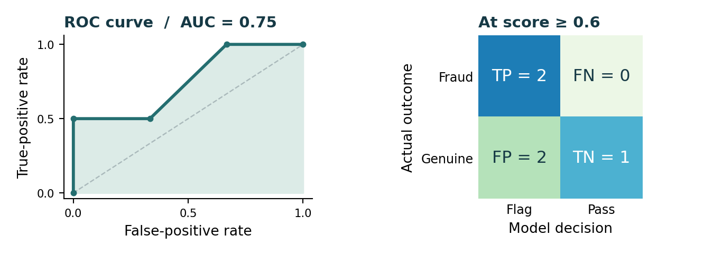

这份笔记面向 **JPMorganChase Risk Program Senior Associate** 和相近的反欺诈建模岗位。问题和参考答案用英文，推导、追问和业务口径用中文。先口答，再对照参考答案。方括号处填入自己能举证的经历，案例数字用来做演算。

**下载**　[PDF 讲义](/notes/chase-risk-interview-prep/chase-risk-interview-prep.pdf) · [可编辑 Word](/notes/chase-risk-interview-prep/chase-risk-interview-prep.docx)

**快速复习**　[逻辑回归](#logistic-regression) · [ROC/AUC 手算](#roc-auc) · [Python/pandas](#python-pandas) · [模型上线演算](#review-capacity) · [60 分钟模拟](#mock-interview)

## 练习路线 {#study-route}

### 三人二面，先练什么 {#study-plan}

JPMorganChase · Risk Program Senior Associate · 公开复习资料

**练习目标**

用英文向三位听众讲清一件事：你如何在做决定时可用的数据上，给交易或新产品申请排序，并判断这个模型能否在可接受的误伤和审核成本下减少欺诈损失。练习时让一人问 “How does it work?”，第二人问 “How do you know?”，第三人问 “Would you launch it?”。

**哪些是已知信息**

这个练习按 60 分钟、三位面试官设计。模拟时可以让三人接力追问，也可以分技术、案例和行为三个时段。

2022 年 Risk Modeling Program 的候选人经历由家属在 2024 年发帖。面经中提到，二面是除经理外几乎全组一起面，从候选人的研究和课程问到逻辑回归、随机森林、Python 和 pandas，当场没有写代码。展示研究在那位候选人的第一轮。博士、统计专业和 R/SAS 是发帖中候选人的背景。

该岗位的 JD 侧重消费银行反欺诈建模，要求 Python 数据分析及至少三类指定方法的商业建模经验，也要求与业务沟通。另有同在 Plano 的风险分析岗候选人回忆，二面三人分别聊业务案例、技术和行为题。两份面经均是相邻岗位的个人经历。

**90 分钟练习路线**

15 分钟｜录一遍自我介绍，再录一个两分钟项目介绍。圈出每个“我做了”的决定，给它配证据。

25 分钟｜闭卷讲完 logistic regression 的假设、link、odds ratio、dummy、共线性。手算一次混淆矩阵和 AUC。

25 分钟｜比较两个模型，在相同审核量下做上线决定。要求自己用英文报出分母、金额和未知量。

15 分钟｜挑你最熟的树模型和另一种模型，解释为何选、如何验证。敲一遍 pandas 代码。

10 分钟｜练一个意见相左的故事，准备两个反问。最后用一句话回答 “Why this role?”。

**使用手册**

英文段落可以直接练口述。方括号要替换成你自己的事实；案例里的数字仅供演算。第一次看中文理清思路，第二次遮住英文回答，第三次请人打断追问。面试当天优先看最后一页。

## 自我介绍与项目深挖 {#project-stories}

### 开场 60 秒与项目证据 {#introduction}

先写三行事实，再练英文。每行都应能回答 “How do you know?”。

**Tell us about yourself.**

> I’m a [role or field] with experience in [relevant problem]. Most recently, I worked on [one project]. I was responsible for [one decision you owned]. I compared [approaches] using [test that matched the use case], and we found [verified result]. The part I’d bring to Chase is [specific skill]. I’m interested in this team because choosing which transactions to flag means balancing the losses we can prevent against the experience of customers making genuine payments.

如果成果是论文、实验或离线改进，可以说 “On our held-out data, we found …”。如果确实上线，补观察期、基线和量化结果。把第一句话控制在十五秒以内，给对方留下可追问的项目细节。

**Which three techniques have you used commercially?**

> I’ve used [method] for [decision], [method] for [decision], and [method] for [decision]. The one I know best is [method]. I can walk you through how I chose it, how I tested it, and one case where it failed.

请在草稿写三行，每行填“方法 → 场景和规模 → 你负责什么 → 和谁比 → 有什么证据”。JD 把 RF/GBM 列为同一组，CNN/RNN 也列为同一组，盘点时按 JD 分组。优先准备你最有证据的三类，图和序列模型另备选型思路。

**What if your strongest language or model differs from ours?**

> Most of my production work has been in [tool or model]. In Python, I’ve personally used [specific library] for [task], and I checked the output by [specific test]. My exposure to [other method] is [coursework, prototype, or none]. For this problem I’d start with [baseline] and test whether [method] adds value under the same constraints.

如果只有一两类商业经验，直接说清范围，再讲一个可迁移的技能或已做过的原型。开场前准备一项真实数据规模、一项真实结果、一次尝试失败或改变判断的例子。

### 项目深挖与个人贡献 {#project-deep-dive}

**Walk us through a model you built. What decision did it support?**

> My best example is [project]. The person using the result was [decision maker]. They had to decide [specific action] by [deadline], and a bad call meant [consequence]. My part was [your own contribution]. I started with [baseline] because it gave us a clear point of comparison. I then tried [method] to capture [pattern the baseline missed].

> The most important test was [validation you actually ran]. I chose it because [why it matched the intended use]. On [evaluation period or test set], I observed [result], though [limitation] limits how far I would generalize. Based on that evidence, I recommended [action]. The last outcome I personally verified was [outcome].

用真实经历替换方括号。只有离线实验，就说测试集上的结果及下一步验证方法。

**What did you personally decide? What would have changed your mind?**

> I owned the decision about [specific choice]. [Colleague or team] owned [their contribution]. I compared [two options] on the same [data and metric]. What convinced me was [specific observation]. If [alternative result] had held up on [test], I would have picked [other option] because [reason].

中文抓手是“我选了什么、同事负责什么、哪条证据会让我改选”。

**How would that experience transfer to fraud?**

> My direct experience is in [domain]. The closest parallel is [genuine similarity]. One difference I would account for in payments is that a dispute can arrive weeks after a transaction. I would check when each feature and label became available before trusting a historical evaluation.

没有反欺诈项目时，讲一个真正相似的问题，再指出迁移到支付场景需要补做的验证。

**If your project was research, how would you test it in practice?**

> In the research setting, I could observe [what you measured], but I had no way to observe [business outcome]. My first practical test would be [small feasible trial]. I would compare it with [current process] under the same [constraints]. Before starting, I would agree with the decision maker on which result would justify a wider rollout.

研究经历也可以讲扎实，尤其是从研究指标走到业务决策之间还缺哪项证据。

## 统计与 Python 面试题 {#statistics-python}

### 逻辑回归｜从模型讲到假设 {#logistic-regression}

**What does logistic regression estimate? What is its link function?**

> It estimates the probability of a binary outcome given the features. The logit links that probability to a linear predictor: log(p/(1−p)) = β₀ + βᵀx. The inverse link is the sigmoid. Holding other variables fixed, a one-unit increase in a predictor multiplies the odds by exp(β), assuming no interaction involving that predictor.

追问系数。若 β = ln(2)，赔率翻倍。原概率 20% 时，赔率从 1:4 变成 1:2，新概率约 33.3%。

**How do you fit the model?**

> I maximize the Bernoulli log-likelihood, equivalently minimizing binary cross-entropy. For each example the loss is −[y log p + (1−y) log(1−p)]. A solver updates the coefficients iteratively. I tune any regularization on validation data and evaluate once on a later test period.

追问梯度。平均损失对系数的梯度是 Xᵀ(p−y)/n。L1 可产生零系数，L2 会收缩系数。

**Which assumptions would you check with transaction data?**

> I would check the binary outcome definition, whether continuous effects are adequately modeled on the log-odds scale, and whether the design has redundant predictors. A finite, unpenalized fit also requires avoiding complete or quasi-complete separation. Transactions within the same account may be correlated. For inference I would consider cluster-robust standard errors, and for prediction I would validate on future transactions.

常见追问。特征无需服从正态分布。非线性可用样条或交互项，预测未来时要保证特征在交易当时可得。

### 编码与分类指标｜一组数据算三遍 {#roc-auc}

**How would you encode a categorical variable and handle multicollinearity?**

> With an intercept and K unordered categories, I usually use K−1 indicator columns. Each coefficient compares its category with the reference on the log-odds scale. Perfect collinearity makes unpenalized coefficients unidentifiable. Strong collinearity can make them unstable. I check redundant definitions, correlations and, when useful, VIF. Then I combine features, remove one, or use ridge if prediction is the goal.

追问部署。把类别映射固定在训练阶段，为新类别定义回退规则。

**How do you build a confusion matrix?**

> Suppose two frauds score .9 and .6, and three legitimate transactions score .8, .6 and .1. If scores of .6 or above are flagged, TP = 2, FP = 2, TN = 1 and FN = 0. Precision is 2/4, recall is 2/2 and the false-positive rate is 2/3.

分母要说清。precision 看被标记交易，recall 看实际欺诈，FPR 看实际正常交易。

**How do you draw the ROC curve and calculate AUC by hand?**

> I lower the threshold and plot false-positive rate on x and true-positive rate on y. Moving tied scores together, the points are (0,0), (0,½), (⅓,½), (⅔,1), (1,1). The trapezoidal area is .75. Equivalently, the .9 fraud beats all three negatives. The .6 fraud beats one and ties one. Counting ties as half gives 4.5/6 = .75.

追问。AUC 衡量正负样本的排序。单个阈值的混淆矩阵只提供曲线上的一个点。



### 模型选择｜随机森林与不平衡数据 {#random-forest}

**How does a random forest work, and when would you use it?**

> A random forest fits many decision trees on bootstrap samples. At each split, a tree considers a random subset of features. These choices reduce correlation between trees. For classification I can average the trees’ class probabilities. I would try it on tabular data with nonlinearities and interactions, and compare it with a simpler baseline on a later time period.

追问。袋外样本可作训练期诊断，同一账户反复交易时，最终仍要用时间外样本评估。

**How would you tune it? How does it compare with boosting?**

> I start with enough trees for stable validation results, then tune depth, minimum leaf size and the number of candidate features per split. Larger leaves can stabilize estimates for rare events. A forest trains trees independently. Gradient boosting builds trees sequentially to improve the current ensemble. I compare both at the same review capacity, then check latency and calibration.

延伸。基于分裂增益的重要性可能偏爱高基数变量，可用时间外样本做 permutation importance，并留意特征相关性。

**What if accuracy is 99.9% but the bank still loses money?**

> At a fraud rate of 0.1%, approving everything already gives 99.9% accuracy. I would inspect precision and recall at our review limit, the percentage of fraud dollars captured, and the number of genuine customers affected. I would also check calibration if probabilities are used to estimate losses.

讲清动作。被标记的交易可能进入复核、验证或拒绝，不同动作的客户成本和实际止损率不同。

### Python 与 pandas｜说完再写 {#python-pandas}

**What is the difference between a tuple and a list?**

> Both are ordered sequences that allow duplicates. A list is mutable. A tuple fixes the collection of references after creation. A tuple can contain a mutable object such as a list, and it can serve as a dictionary key only when all its elements are hashable.

```python
account_key = ("checking", 42)
scores = [0.78, 0.91]
scores.append(0.84)
```

追问。单元素元组写作 (42,)，逗号决定它是元组。

**How would you rename a column and delete another in pandas?**

> I pass a mapping to rename and a column list to drop. I assign the result to a new variable so the transformations are easy to follow. If these columns are required by the scoring pipeline, I check the schema and fail early if one is missing.

```python
clean = df.rename(columns={"amt": "amount"}, errors="raise")
clean = clean.drop(columns=["unused"])
```

追问。drop 的默认轴是行，删列时显式写 columns。

**How would you calculate precision and recall at an agreed threshold?**

> I would make sure labels are mature and binary, and that each row has a valid score. I apply the threshold to obtain alerts, count the true positives, and divide by the number of alerts for precision or the number of frauds for recall. If a denominator is zero, I report the metric as undefined.

```python
alert = df["score"].ge(0.6)
fraud = df["is_fraud"].eq(1)
tp = (alert & fraud).sum()
precision = tp / alert.sum() if alert.any() else float("nan")
recall = tp / fraud.sum() if fraud.any() else float("nan")
```

口答后可用前面的五笔交易核对，precision = 0.5，recall = 1.0。

## 反欺诈建模与业务阈值 {#fraud-modeling}

### 如何设计反欺诈模型 {#fraud-score}

Start with the decision the score will change. 先说明预测发生在什么时候，以及谁会据此采取行动。

**How would you design a model for suspicious transactions?**

> I would clarify whether the score drives a decline, a verification prompt or a review queue. I would also ask when the decision must be made, how many cases the team can handle and when we learn the outcome. For a transaction score, my training unit would be one authorization attempt. I would agree on a fraud definition with operations and allow enough time for disputes to mature. A new product application needs its own decision point and outcome window. A fraudulent application might only be discovered after the account opens. I would compare a simple baseline with gradient boosted trees using the same information available at decision time. Useful signals might include how unusual the amount is for this customer and how many distinct accounts recently used the device.

中文提示。先定交易或申请的评分时点，再定标签。支付争议和开户后发现的身份欺诈，确认时间可能不同。

**How would you convince me the offline result is real?**

> I would train on older periods, tune the threshold on a later period, then evaluate once on a final period with mature labels. For each historical transaction, I would rebuild its features using records that had already arrived. A fraud flag added after the dispute is a simple leakage test. I would compare models at the same review volume and report precision, fraud dollars captured and the number of legitimate customers affected. I would also inspect results by channel and for new customers. Historically declined transactions often have no observed outcome. Before claiming the savings will generalize, I would explain that gap and propose a controlled rollout with agreed loss and customer impact limits.

中文提示。如果交易当时就被拒绝，事后没收到投诉不等于交易真实。用时间外测试，并说明哪些成本仍要上线验证。

### 如何选择反欺诈模型 {#model-choice}

Explain what each model can learn and how you would test its incremental value. 用同一业务约束比较方法。

**When would graph features justify their complexity?**

> I would start with a tree model using tabular features. It is quick to benchmark and can represent nonlinear interactions. A graph could help when accounts that look ordinary individually share devices or other identifiers. I would build timestamped edges and try simple features first, such as the number of distinct accounts on a device in the previous week. If those help, I would test whether neighborhood representations or community features add value over the same baseline. Shared devices in a household can look suspicious for legitimate reasons. I would inspect those false positives and measure lift on new accounts at a fixed review budget. I would also test what happens when the graph service falls behind.

中文提示。说清节点、边、时间范围。先看简单图特征的增益，再讨论是否值得上图神经网络。

**When would you try a Transformer for transaction histories?**

> I would test a sequence model if the order and timing of events carry information that rolling aggregates miss. For example, the same set of events could imply a different risk when a device change immediately precedes a payment. I would encode the event type, time gap and available attributes, ending each input sequence at the scoring instant. I would compare performance with a tree model using strong rolling features and an RNN baseline. I would check the gain for customers with short histories, serving latency and inference cost. If the sequence model improves offline ranking but misses the authorization deadline, I would test a smaller model or use it for cases where the decision can wait.

中文提示。若被问哪三类技术做过商业应用，按真实经历回答。此处展示怎样选型，不能替代自己的项目证据。

### 如何设定业务阈值 {#thresholds}

Compare actions using expected dollars and customer impact. 以下数字只为演示，均为假设值。

**A transaction has a calibrated fraud probability. Would you block it?**

> I would first ask what loss the bank bears if the payment clears and what harm a false decline causes. Suppose allowing a fraudulent payment costs 100 dollars, declining a legitimate one costs 5 dollars, and a decline prevents the entire fraud loss. With fraud probability p, the expected cost of allowing is 100 times p. The expected cost of declining is 5 times one minus p. The break-even probability is 5 divided by 105, about 4.8 percent. A score of 6 percent would favor a decline under those assumptions. The cutoff changes if the amount, recovery rate or cost of disrupting the customer changes. I would verify calibration near the proposed cutoff and compare step-up verification as a third option.

中文提示。在这个简化例子里，风险为 6% 时，放行的预期成本是 6 美元，拒绝是 4.70 美元。

**Operations can review only 500 cases per day. Which cases get a slot?**

> I would estimate the benefit of review compared with the action we would otherwise take for each case. That means accounting for the loss an analyst can realistically prevent, the cost of the review, and the extra delay for a legitimate customer. I would rank by expected net benefit and review up to 500 positive-benefit cases, assuming each takes similar time. I would compare the proposed queue with the current one at the same capacity. For a pilot, I would track net losses, legitimate customers delayed, time to decision and precision among reviewed cases. If waiting times spike, I would adjust the routing immediately and wait for mature fraud labels before making a claim about savings.

中文提示。同样的欺诈概率，交易金额、可追回金额和复核能否改变结果不同，排队优先级也会不同。

## 反欺诈案例与实操 {#case-studies}

### 从模型分数到业务决策 {#review-capacity}

演算题 ｜ 先自己算，再读英文答案

**A and B can each flag 1,000 transactions. Which one should we use?**

假设某验证周有 100,000 笔交易，其中 200 笔已确认欺诈。旧模型 A 的前 1,000 笔命中 120 笔，涉诈金额共 &#36;36,000。新模型 B 的前 1,000 笔命中 130 笔，涉诈金额共 &#36;32,500。两者均引导人工核查。

> At the same review volume, B finds ten more fraud cases. Its precision is 13% and its recall is 65%, versus 12% and 60% for A. But A captures &#36;3,500 more in historical fraud exposure. If the objective is preventable dollar loss and the intervention works equally well for both queues, I’d keep A as the baseline. I’d check whether a few large cases drive the result and how much of that exposure reviewers can actually prevent.

**What if we can prevent only half the flagged fraud dollars?**

再假设两组核查均能避免 50% 的涉诈金额，每笔核查成本 &#36;3，暂忽略客户打扰和其他成本。这是练习中的简化假设。

> A would prevent an estimated &#36;18,000, and B &#36;16,250. Reviewing either queue costs &#36;3,000, so their estimated net benefits are &#36;15,000 and &#36;13,250. Those estimates depend on the prevention rate. I’d validate it with intervention outcomes where available and compare multiple weeks before recommending a rollout.

追问“B 的 PR-AUC 更高呢？”先解释整条曲线描述多个阈值下的表现，生产环境只运行在选定的审核容量或误拒约束上。上例仅给出一个操作点，无法计算完整 PR-AUC。

**Explain your recommendation to the head of operations in two sentences.**

> I’d keep the current queue for now. At the same workload it is estimated to save &#36;1,750 more that week, and I’d repeat the comparison across several weeks and check the effect on genuine customers before changing policy.

容易失分的细节：这里的“命中”只是进入审核，不能把所有正常告警都称为误拒，也不能把涉诈金额直接算成已挽回金额。

### 新申请反欺诈与上线异常 {#applications-and-monitoring}

两道不同的情境 ｜ 先问清决策时点，再给第一步行动

**A new account has no transaction history. How would you score its application?**

> I’d start with the decision we need to make at submission: approve, ask for additional verification, or refer for review. I’d define a confirmed fraud outcome and allow enough time for it to emerge. I’d start with a simple application-level baseline using information available at submission. Then I’d test whether links to previously seen devices or contact details add lift at the same review rate. I’d check false referrals for legitimate households sharing a device and track application completion after additional verification.

追问 “Do declined applications have reliable labels?” 被拒申请后续欺诈结果往往不可观测。把它们一概标成正常会造成选择偏差。先说明可观测范围，找独立核验或受控抽查，并报告结论适用的人群。

**Fraud alerts doubled yesterday. What would you check in the first hour?**

> I’d check the alert rate as well as the count. I’d break out transaction volume, score distributions and action rates by channel, model version and time. Then I’d compare recent data feeds, missing values and policy thresholds with their last known good versions. If a broken feature were sending genuine customers into review, I’d involve operations, contain the impact and use the approved fallback while we investigate. Confirmed fraud arrives later, so I’d label that evidence separately.

追问 “The data pipeline looks healthy. What next?” 区分客群结构变化、真实欺诈模式改变和策略变更。抽样复核告警，查看已成熟窗口的分渠道误报和损失，核对近期产品或营销活动。

**How would you compare a challenger safely?**

> I’d first run both models on the same historical decision points and compare them at the same operational constraint. Next I’d shadow-score live traffic to check feature availability, latency and queue size. Shadow mode cannot tell us the causal effect of blocking a transaction. For that I’d propose a limited rollout with an appropriate comparison group, agreed customer safeguards and rollback conditions.

追问 “What would make you pause?” 某个主要渠道的正常客户验证失败率超过业务预先同意的界限、数据延迟令关键特征缺失，或审核队列超过容量。说明谁有权暂停、何时复查，不用编造银行内部标准。

### Python 实操与数据陷阱 {#python-sql}

自拟练习 ｜ 编辑器里能写，Zoom 上也能讲

**Can you evaluate two sets of fraud scores at a fixed review capacity?**

前提：验证表一行一笔交易，已按时间独立留出，标签已成熟。含 txn_id、score、fraud（0/1）、amount；此例的 score 已生成。生产中还须处理空值、平分和容量变动。

```python
def review_metrics(df, k):
    ranked = df.sort_values(["score", "txn_id"], ascending=[False, True])
    alerts = ranked.head(k)
    hits = alerts["fraud"].eq(1)
    total_fraud = df["fraud"].eq(1).sum()
    return {
        "precision": hits.mean() if len(alerts) else None,
        "recall": hits.sum() / total_fraud if total_fraud else None,
        "flagged_fraud_amount": alerts.loc[hits, "amount"].sum(),
    }
```

> I’d apply the same review capacity to both score columns on the same transactions. I’d check that the IDs are unique, the scores are populated, and the outcomes are mature. The amount in the last line is exposure associated with flagged fraud. Estimating preventable loss requires evidence about the intervention.

**How would you create a velocity feature for the last 24 hours?**

> For a transaction at time t, I’d count the customer’s earlier transactions from t minus 24 hours up to, but excluding, t. I’d use the same event and availability rules in training and online scoring. I’d test two transactions with the same timestamp, a late-arriving event, and a customer with no history.

下面是 SQL 思路题，以支持该时间语法的数据库为例。表假设含 customer_id、event_time 和 available_at。生产大表可以按键和日期分区，利用增量窗口或预聚合降低成本。

```sql
SELECT COUNT(*) FROM transactions h
WHERE h.customer_id = :customer_id
  AND h.event_time >= :t - INTERVAL '24 hours'
  AND h.event_time < :t AND h.available_at <= :t;
```

追问 “Why can a random split look better?” 同一客户或事件的近邻记录跨集合，模型可能见过未来模式；先按时间留出，再用符合真实服务对象的方式检验新客户、老客户和关联实体的表现。预处理也只在训练集拟合。

### 二层追问：指标、规模和模型边界 {#advanced-follow-ups}

自拟延伸 ｜ 回答会用什么，再说什么现象会改变选择

**What if we downsample legitimate transactions to train the model?**

> I’d sample only in the training period and record the sampling scheme. I’d evaluate on an untouched period with the real fraud rate. Sampling or class weighting can change what a raw score means, so I’d check calibration on representative validation data before using it as a probability. I’d inspect precision at our operating point and use a reliability plot to see whether predicted probabilities match observed frequencies.

记住排名和概率的区别。一个模型可以排序很好，却把风险普遍报高。看分箱后的预测均值与实际发生率，尤其是拟启用的阈值附近。随机排序时，precision 的基准约等于欺诈发生率。

**How would you train and score at transaction scale?**

> I’d start by measuring where the time and cost go. For offline training I’d partition by date, read only the needed columns, and precompute point-in-time aggregates. I’d check for skew around high-volume keys before a large join. For serving I’d set a latency budget, version the features and model together, and test a fallback when an online feature is missing. I’d monitor the tail latency and compare online features against replayed examples.

如果被问 Databricks 或 Spark，讲能实际解释的工作。追问 “What’s expensive about a join?” 许多大表连接需要按键跨节点重分配数据；小维表可评估广播，更大的代价常来自热点键和意外的多对多连接。

**Would you use reinforcement learning for fraud decisions?**

> I’d consider it if an action changes future behavior and we can define a meaningful long-term reward. I’d start with a supervised score and an explicit decision policy. Historical records mostly show outcomes for actions the old policy took, so evaluating a new policy can be difficult. I’d study action coverage and the way actions were assigned before trusting any offline policy estimate. I’d work with risk and operations on a tightly bounded evaluation.

CNN/RNN 如何接话？固定长度局部模式可试一维卷积，顺序依赖可试 RNN。举一个具体信号，说明为何聚合特征可能遗漏它，然后与 GBM 比较增益、延迟和稳定性。只有做过商业落地才将其计入个人经历。

## 行为题与业务沟通 {#behavioral}

### 行为题与业务沟通 {#communication}

**Tell us about a disagreement with a stakeholder.**

> On [project], [stakeholder] wanted [action] because [their reason]. I was concerned about [specific consequence]. We agreed that [shared objective] mattered to both of us. I asked what evidence would make them reconsider and shared what would change my view.

> I compared [options] using [evidence]. Their point about [constraint] led me to suggest [change]. We agreed to [decision] and to revisit it if [trigger]. When we checked again, [verified outcome]. My contribution was [specific action].

保留对方最有说服力的理由。如果最终采用对方方案，可以讲哪条证据让你改了主意。

**Why this role? Why Chase?**

> What interests me about this role is the decision behind the score. When a bank flags a legitimate payment, a real customer may be left at the checkout. When it misses fraud, someone bears that loss. I want to work on how a team makes that trade-off across billions of transactions. In [project], I particularly enjoyed [specific work]. That is the part of my experience I would bring to Chase.

补一句自己做过、也确实喜欢的工作，例如分析误报或比较两个模型。

**Explain your recommendation to a business leader in thirty seconds.**

> My recommendation is [action]. It should help us [business outcome]. The main downside is [cost or customer impact]. I would start with [limited scope], track [one benefit and one cost], and pause if [agreed limit]. The decision I need today is [specific approval or next step].

先给结论。如果对方追问数字，补上分母、时间范围，以及数字来自离线测试还是实际运行。

**Tell us about a mistake you caught late.**

> I made an assumption that [assumption]. I first saw a warning sign when [observation]. I reproduced it on [small example], told [affected person] what conclusions were at risk, and reran [analysis]. The correction changed [result or recommendation]. Since then, I have used [specific check] to catch the same problem earlier.

用一个真实失误，交代如何通知受影响的人，以及纠正后决定有没有改变。

**Where do you want to grow over the next few years?**

> In the first six months, I’d want to understand one fraud decision well enough to explain its labels, customers, current policy and success metrics. Then I’d like to own a model improvement from design through monitoring. Over time, I’d like to take responsibility for [genuine career interest]. I’d be interested to hear how ownership develops on this team.

与真实职业目标对齐。若面试官问你对岗位的期望，选一个希望独立负责的决策，说明成功的样子。

## 60 分钟模拟和面前速查 {#mock-round}

### 三人 60 分钟模拟面试 {#mock-interview}

自拟脚本 ｜ 请朋友计时并打断，或者用手机先录音、再回听

**0–10 min　开场与项目选择**

A: “Tell us about yourself. Pick one project that’s most relevant here.” 用 60 秒介绍自己、两分钟讲项目。B 立刻追问 “Which decision was yours?” C 问 “What evidence would make you choose another model?” 合格线是能说出本人贡献、对照基线、评估窗口和一项局限。

**10–25 min　技术连续追问**

A: “Write the logit. What does doubling the odds mean?” B: “With an intercept and five categories, how many indicator columns?” C: “Here are scores .9 and .6 for fraud, .8, .6 and .1 for genuine transactions. Draw the ROC.” 核对点是 4 个 dummy、并列一正一负计半、AUC = 0.75。接着用英文讲随机森林的两层随机性，口述 pandas 改列名和删列。

**25–43 min　反欺诈业务案例**

B: “The new model catches ten more frauds in the same 1,000 review slots. Would you switch?” A: “It catches fewer dollars. Does that change your answer?” C: “Half the labels from last week are still pending. What can you tell me today?” 答到涉诈金额与可防损失、审核容量以及标签窗口。今天可以报告告警量和系统延迟，损失结论要等待标签成熟或明确估计假设。

**43–54 min　合作、沟通与失误**

C: “Product wants fewer verification prompts. Operations wants less fraud. What would you do?” 然后追问 “Tell me about a real disagreement.” 先给可测的共同目标，再用一个真实项目讲清如何取得决定、谁负责以及结果。

**54–60 min　反问与收尾**

> Which decision would this person own in the first six months, and what would tell you they were doing it well?

> When two models trade off fraud dollars and customer friction differently, how do modeling and operations agree on the operating point?

> Which is the harder problem for the team today: getting reliable labels, improving the signal, or turning scores into actions? Could you give me an example?

挑两题，听完第一题的回答再决定第二题。收尾可用 “I was especially interested in what you said about [their answer]. It connects directly to [one relevant experience]. Thank you for your time.”

**录音后评分**

每项 0–2 分：个人贡献、技术正确性、数据和时间口径、业务判断、表达与倾听。0 是答不出，1 是能概述，2 是能举证且接住追问。挑最低的两项重录；此评分只用于练习。

### 面试前一页速查 {#last-minute}

用 10 天练习和复盘，每个阶段留出一次闭卷口答

**10 天练习安排**

第 1–3 天　写一张个人项目事实卡、三个真实故事；录开场。过一遍截图全部原题，白纸手算 ROC/AUC。每次练习 45–60 分钟。

第 4–6 天　轮流练交易和新申请两种 case。一天谈标签和泄漏，一天谈模型选型，一天练阈值与金额。把 pandas 例子亲手敲一遍。

第 7–8 天　做一次完整三人模拟。回听并标出第一次讲不清楚的追问。次日只修最弱两项，再练一个自己没有直接经验的问题。

第 9 天　再做一次计时模拟，反问准备两道；把简历每个数字的基线、分母和观察期查清楚。

第 10 天　开场、一个项目、两个分母、一句业务建议。连线前检查摄像头和声音。

**五句能接住追问的英文**

> Could I clarify what happens when a transaction is flagged? Is it reviewed, challenged, or declined?

> I’m assuming the review capacity is fixed. Under that assumption, I’d compare the models at the same daily volume.

> That result was measured offline. The outcome I could verify in production was [actual evidence, if available].

> I haven’t used that method in production. The closest comparison I’ve made is [real example]. Here’s how I’d test it.

> Let me correct the denominator. The false-positive rate is false alerts divided by all genuine transactions.

**进场前闭卷自测**

① 能否在 30 秒内讲完 logit、odds 和一个系数实例？ ② 能否手算五笔交易的 AUC？ ③ 给你 500 个审核名额，你会比较什么？ ④ 哪个特征最可能泄漏未来？ ⑤ 哪个上线结果会让你暂停策略？ ⑥ 你项目里的哪项决定是你亲自做的？

**职位与面经出处**

- [同编号完整职位说明 · The Muse](https://www.themuse.com/jobs/jpmorganchase/risk-program-senior-associate-1cca3d)
- [JPMorganChase 职位发布 · LinkedIn](https://www.linkedin.com/jobs/view/risk-program-senior-associate-at-jpmorganchase-4466061573)
- [2022 Risk Modeling Program 经历 · 一亩三分地](https://www.1point3acres.com/bbs/thread-1085929-1-1.html)
- [2023 Plano Risk Strategic Analytics, Associate 二面 · Glassdoor](https://www.glassdoor.com/Interview/JPMorganChase-Interview-Questions-E5224839.htm?filter.jobTitleExact=+Risk+Strategic+Analytics%2C+Associate)
- [JPMorganChase Fraud Optimization 与 Quant Analytics 面后反馈 · Reddit](https://www.reddit.com/r/JPMorganChase/comments/1uq48x9/interview_coming_up_for_jpmorgan_quant_analytics/)

也可复习网站上的通用机器学习题和生产模型评估案例。 [ML 基础与 AI 面试复习路线](/zh/notes/ml-ai-interview-prep/)
